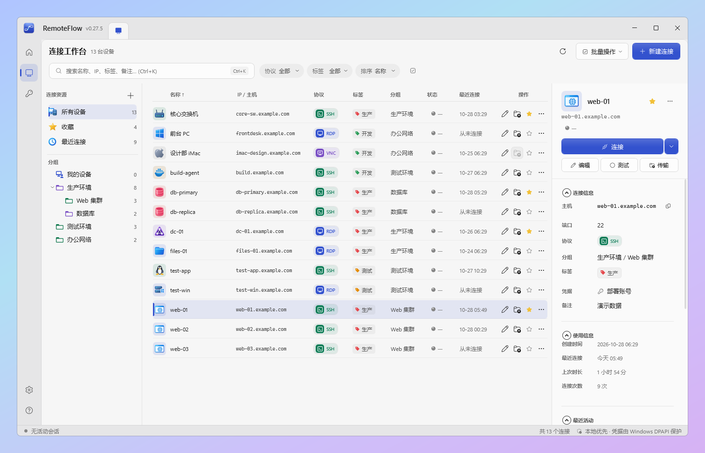
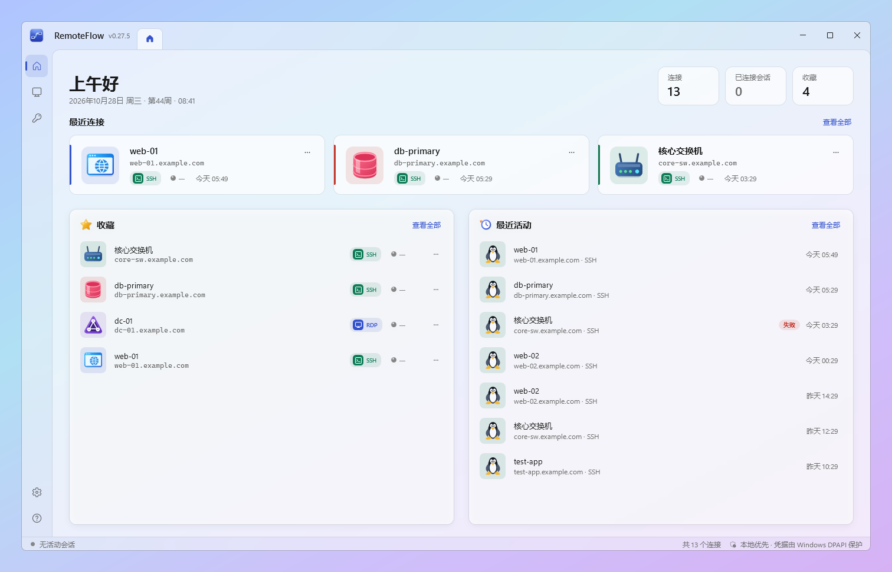
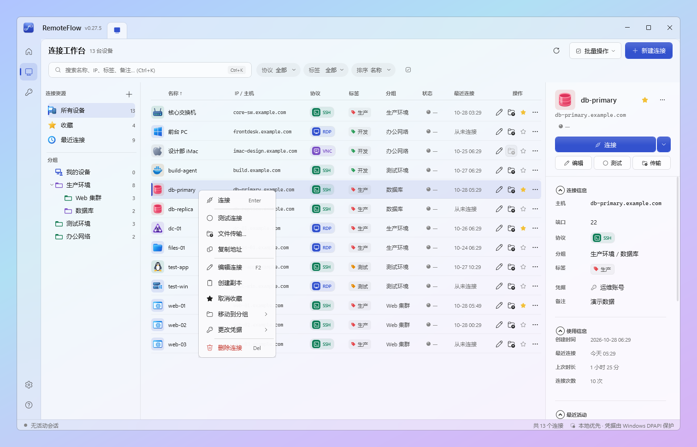
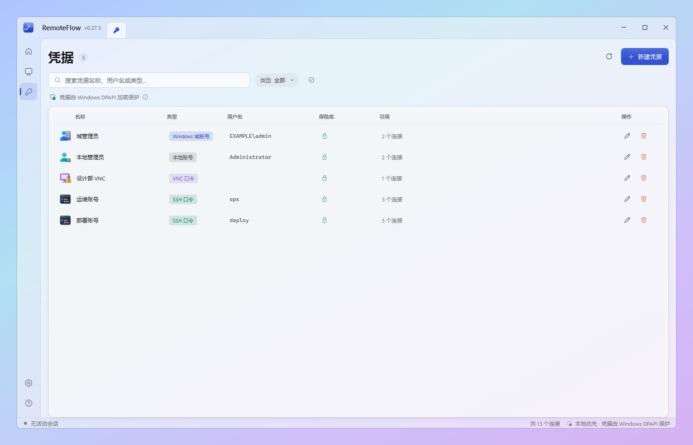
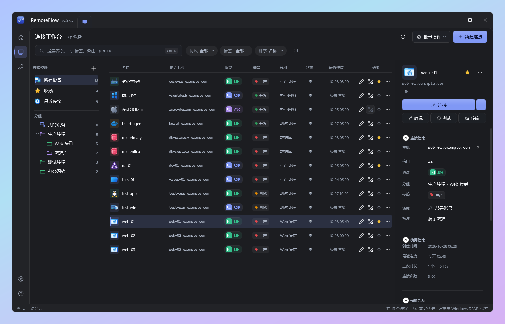
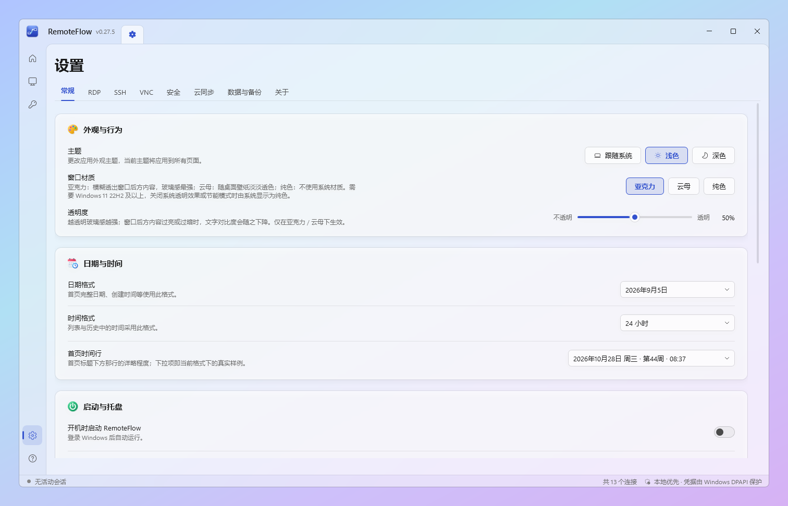
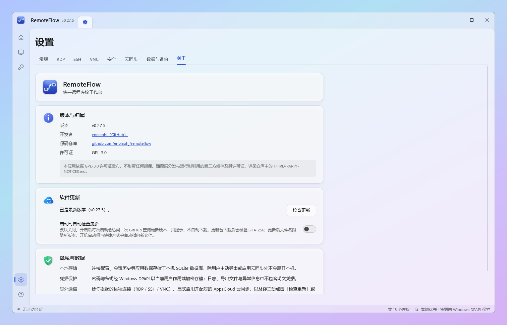

# RemoteFlow

> **统一远程连接工作台 · Unified Remote Connection Workspace**
> 让 RDP、SSH、VNC 进入同一个工作流：一个窗口管理主机、凭据与会话。

[](https://github.com/enpiaohj/remoteflow/releases/latest)
[](LICENSE)


RemoteFlow 是面向 IT 运维、系统管理员、开发与技术支持人员的开源桌面客户端，
提供 **Windows 版（WPF）** 与 **macOS 原生版（AppKit）**——两端共享同一套领域模型与
ViewModel（`RemoteFlow.Core` + `RemoteFlow.Presentation`），各自用平台原生 UI 呈现。

它把分散的 RDP 文件、PuTTY / 终端、VNC 客户端和记在 Excel 里的服务器清单，
收敛到一个现代、克制、启动快、连接路径短的工作台里。

**它不是** TeamViewer / AnyDesk 这类公网穿透远控产品，
而是解决「主机多、工具散、凭据重复配置、临时记录到处飞」的高频痛点。

## 目录

- [亮点](#亮点) · [截图](#截图) · [下载与安装](#下载与安装) · [快速上手](#快速上手)
- [功能](#功能) · [云同步（可选）](#云同步可选) · [安全模型](#安全模型)
- [技术栈](#技术栈) · [解决方案结构](#解决方案结构) · [构建与运行](#构建与运行windows)
- [反馈与贡献](#反馈与贡献) · [License](#license)

---

## 亮点

- **一个工作台，三种协议**：RDP / SSH / VNC 统一 Tab 外壳，多会话并行，切 Tab 不断开。
- **主机与凭据分开管理**：账号密码 / 私钥建成凭据，多台主机共用，改密码只改一处；
  从凭据一键新建主机、创建副本、批量改引用。
- **批量连接**：勾选多台主机一键连接，逐台打开并等待真正开始连接，失败的统一汇总、不连环弹框。
- **完全全屏也不迷路**：三档全屏循环（`F11`），顶部悬浮胶囊可拖动 / 固定 / 自动隐藏，
  找不到工具条时按 `Ctrl+Alt+F12` 居中找回。
- **文件传输**：SSH 会话内 SFTP 侧栏；也可不建会话直接对主机传文件，RDP 主机走 SMB 管理共享或 SFTP。
- **本地优先、安全默认**：不强制登录、不依赖云服务；密码与私钥由系统密钥库加密，连接库只存引用；
  SSH 主机密钥首次信任、变化强警告。
- **可选端到端加密云同步**：多设备同步连接与凭据，服务器只持有密文。

---

## 截图

> 截图取自 Windows 版 v0.27.5，窗口为默认的亚克力玻璃外观；其中的连接、主机名与凭据均为**演示数据**
> （主机一律是 `example.com`），背景是为截图铺设的渐变幕布。此后版本的界面细节以实际运行为准。

**连接工作台**——分组树、连接列表与详情面板，日常使用的主界面；顶部是协议 / 标签 / 状态筛选与排序胶囊，点列头也可排序；每行右侧有「编辑」「文件传输」「收藏」「更多」快捷图标：



| 首页 | 右键菜单 |
| --- | --- |
|  |  |
| 最近连接、收藏与最近活动，打开应用即可继续上次的工作 | 全应用菜单统一分组与叫法，标注真实可用的快捷键，删除类操作用警示色并放在最后 |

| 凭据 | 深色主题 |
| --- | --- |
|  |  |
| 密码与私钥由 Windows DPAPI 加密单独保存，列表只显示元数据 | 浅色 / 深色 / 跟随系统 |

| 设置 | 软件更新与关于 |
| --- | --- |
|  |  |
| 主题、窗口材质（亚克力 / 云母 / 纯色）与透明度、日期时间格式、启动与托盘 | 位于「设置 → 关于」：应用内检查与安装更新，默认不自动联网 |

远程会话（RDP / SSH / VNC）与文件传输界面需要连接真实主机，暂未提供截图。

---

## 下载与安装

**Windows**（Windows 11，x64）

1. 到 [Releases](https://github.com/enpiaohj/remoteflow/releases/latest) 下载
   `RemoteFlow-v<版本>-win-x64.exe`（单文件、自包含，无需安装 .NET）。
   同一版本另有 `.zip`，内容相同并附带终端资源目录。
2. 放到一个**有写入权限的目录**后直接运行（放在 `Program Files` 下将无法使用应用内更新）。
3. SSH 终端依赖 [Microsoft Edge WebView2 运行时](https://developer.microsoft.com/microsoft-edge/webview2/)，
   Windows 11 通常已内置。

注意：

- 发布产物**没有代码签名**，首次运行时 Windows 可能提示「未知发布者」。每个版本的 SHA-256 记录在
  [CHANGELOG.md](CHANGELOG.md) 与对应的 Release 页面，可自行核对。
- **应用内更新**：在「设置 → 关于 → 软件更新」检查并安装；导航栏左下角 ℹ、托盘菜单「检查更新」
  也会直达这里。更新后文件名跟随新版本，开机启动项与快捷方式自动指向新文件。
- 开启「开机时启动」后，随系统启动时应用直接驻留托盘，手动打开才显示窗口。
- 每个版本的变更见 [CHANGELOG.md](CHANGELOG.md)。

**macOS**（macOS 13+）

macOS 版是独立版本线，发布标签形如 `macos-v0.x.y`，在
[Releases 列表](https://github.com/enpiaohj/remoteflow/releases) 中查找带 `macOS` 字样的条目下载 DMG。
macOS 版的功能进度落后于 Windows 版：文件传输、应用内更新、统一右键菜单、批量连接逐台打开等
标注「Windows」的能力暂未提供。

---

## 快速上手

1. **新建连接**：在首页或「连接工作台」点「新建连接」，选择协议（RDP / SSH / VNC），填写主机与端口；
   可以先不指定凭据。点「保存并连接」直接开始。
2. **管理凭据**：在「凭据」页新建账号（Windows 域 / 本地 / SSH 口令 / SSH 私钥 / VNC 口令），
   连接里选择引用即可。右键一条凭据可以「新建连接」（直接引用该凭据，连接名预填为账户名）或「创建副本」；
   在连接上右键「更改凭据」只改引用、不动凭据本身。
3. **连接**：双击或 `Enter`。要连多台：点列表上方的清单图标进入批量选择，勾选后「批量连接」——
   会逐台打开，全部处理完后若有失败，会弹一条汇总（哪几台、什么原因），失败的会话仍在标签页里，可「重新连接」。
4. **全屏与工具条**：`F11` 在「常规 → 窗口最大化 → 完全全屏」间循环。完全全屏下，把鼠标移到屏幕顶边
   胶囊所在位置即可唤出工具条；找不到时按 `Ctrl+Alt+F12`（或 `Ctrl+Alt+Home`）居中找回。
   胶囊上右键有「重新连接」等会话菜单。
5. **传文件**：连接行右侧的「文件传输」图标（或右键「文件传输…」）在新标签页打开；SSH 会话内也可用右侧 SFTP 侧栏；
   RDP 会话工具条（含全屏胶囊）在「发送 Ctrl+Alt+Del」旁有文件传输按钮。
6. **更新**：「设置 → 关于 → 软件更新」。

---

## 功能

### 连接与会话

| 能力 | 说明 |
| --- | --- |
| 多协议会话 | RDP / SSH / VNC（含 macOS 屏幕共享），统一 Tab 外壳，多会话并行；折叠的会话选择器显示会话数并可直接关闭当前会话 |
| 三档全屏 | 常规 → 窗口最大化（保留标题栏）→ 完全全屏，`F11` 逐档循环；可拖动（仅沿屏幕顶部横向）/ 可固定 / 自动隐藏的悬浮胶囊工具条盖在原生画面之上；仅在胶囊所在位置的顶边呼出，`Ctrl+Alt+F12` / `Ctrl+Alt+Home` 居中找回；右键菜单；会话中断时显示带「重新连接 / 关闭会话 / 退出全屏」的恢复卡片 |
| 批量连接 | 勾选多台逐台打开：每个会话保持选中、等它真正开始连接再开下一个，不会停在「准备中」；达到并发上限提前停止；结束后统一汇总失败原因，不连环弹框 |
| 会话生命周期 | 统一状态机与资源清理，断线可见状态，重连不残留；关闭主窗口或托盘退出且有活动会话时先确认 |
| 实时状态同步 | SessionManager 唯一状态源，首页 / 列表 / 详情 / 托盘 / 状态栏随会话实时一致；连接成功后「最近连接」立即更新；首页与工作台按主机做轻量 TCP 在线探测 |
| 连接质量详情 | 常驻条 / 胶囊的状态入口打开：连接状态、会话时长、重连次数、质量指标，可重新检测 |
| RDP 工具 | 发送 `Ctrl+Alt+Del`、启动远端任务管理器、缩放 / 适应窗口、文件传输入口；Windows 版按本机 DPI 协商远端缩放，登录、跨屏与切回会话后同步显示；按连接设置颜色深度（32 / 24 / 16 / 15 位，Windows）；兼容 Windows Server 2003 等较老系统 |
| SSH 终端 | xterm.js（WebView2 / WKWebView 承载）：WebGL 渲染、六套主题、字体 / 字号、右键菜单（复制 / 粘贴 / 粘贴选中 / 查找 / 清屏）、输出内搜索（`Ctrl+Shift+F`）、粘贴安全（多行 / 大文本确认）、括号粘贴开关、中文输入法直输 |
| VNC 画面 | 三档缩放（等比 / 拉伸 / 1:1）、本地零延迟光标、剪贴板远端→本机 |
| 文件传输（Windows） | SSH 会话内右侧 SFTP 侧栏；也可**不建会话**，在主窗口 Tab 里直接对主机传文件（SSH 走 SFTP，RDP 主机走 **SMB 管理共享**或 SFTP，按连接选择，VNC 不支持）。浏览 / 上传下载文件与文件夹 / 进度队列与取消 / 新建、重命名、删除 / 覆盖确认 / 复制路径；下载先写 `.rfpart` 再原子改名、远端文件名净化防路径穿越、不跟随符号链接。SFTP / SMB 通道未在全部环境验证，macOS 版暂无（详见 [文件传输说明](docs/2026-09-30-RemoteFlow-v0.24.0-文件传输说明-v1.1.md)） |
| 连接测试 | 统一对话框：DNS / Ping / TCP 三步诊断，失败给原因与详情 |

### 资产与组织

| 能力 | 说明 |
| --- | --- |
| 连接资产管理 | 新建 / 编辑 / 创建副本 / 删除，协议 / 标签 / 状态筛选（胶囊式，可一键清除）与点列头排序，批量操作（批量连接、收藏、移动分组、加减标签、删除），多级分组、跨分组标签、收藏、连接历史；永久内置「我的设备」「未分组」，自定义分组可选 12 种组织图标，标签支持图标 + 颜色（详见 [分组、标签与图标说明](docs/2026-09-27-RemoteFlow-v0.21.0-分组标签图标与状态刷新说明-v1.0.md)） |
| 凭据管理 | 类型：Windows 域 / 本地 / SSH 口令 / SSH 私钥 / VNC 口令；列表显示被引用的连接数；**创建副本**（Secret 另存一份）、**新建连接**（直接引用此凭据）、连接上**更改凭据**、批量更改类型 / 删除；列表空白处右键可直接新建凭据或主机 |
| 全局搜索 | 按名称、IP、分组、标签、备注即时过滤，`Ctrl+K` 聚焦 |
| 导入 / 导出 | 连接 CSV（不含 Secret）、凭据加密备份 `.rfbackup`（AES-256-GCM + PBKDF2） |
| 统一的右键菜单 | 全应用右键菜单遵循同一约定：分组顺序固定、破坏性操作用警示色并放在最后、动作带图标；连接 / 首页 / 会话标签 / 文件传输标签 / 凭据 / 分组 / 文件列表均有对应菜单，列表空白处也有新建入口；标注的快捷键（`Enter` / `F2` / `Del` / `F11` / `Ctrl+W`）都是真实绑定（详见 [在线更新与右键菜单说明](docs/2026-10-13-RemoteFlow-v0.25.0-在线更新与右键菜单说明-v1.2.md)） |

### 安全

| 能力 | 说明 |
| --- | --- |
| Credential Vault | 密码 / 私钥由平台密钥库加密单独保存（Windows DPAPI / macOS Keychain），连接库只存引用；界面不显示已保存的 Secret，密码框聚焦且开启大写锁定时给出提示 |
| SSH Host Key 校验 | 首次连接记录指纹（TOFU），指纹变化时强警告，杜绝无感中间人 |
| 本地优先 | 不强制登录、不依赖云服务即可完整使用 |

### 外观与系统集成

| 能力 | 说明 |
| --- | --- |
| 统一视觉语言 | 12 种设备类型矢量图标（与协议正交）、协议徽章（RDP 蓝 / SSH 绿 / VNC 紫）、全应用一致的状态色；操作图标统一为 Fluent 线性图标，凭据类型 / 设置分区使用彩色身份图标（详见 [图标体系说明](docs/2026-09-27-RemoteFlow-v0.23.0-图标体系说明-v1.0.md)） |
| 深浅主题 | 浅色 / 深色 / 跟随系统（默认跟随系统） |
| 玻璃外观 | Windows 11 22H2+ 系统材质：亚克力 / 云母 / 纯色可选，透明度 0–100% 可调；对话框统一亚克力（详见 [玻璃外观说明](docs/2026-09-27-RemoteFlow-v0.22.0-玻璃外观说明-v1.0.md)） |
| 托盘控制 | 托盘菜单与应用内菜单同一套样式：打开 / 隐藏、新建连接（预选协议）、最近连接、活动会话（可断开全部）、设置、开机启动、检查更新、退出；悬停提示显示版本号、各状态的会话数（已连接 / 连接中 / 异常）和会话名；双击托盘图标显示 / 隐藏；开启「关闭窗口时最小化到通知区域」时，托盘退出也会先确认活动会话；**随系统启动时直接驻留托盘** |
| 应用内更新（Windows） | 「设置 → 关于 → 软件更新」检查、下载并更新；发布源为本仓库的 GitHub Releases，下载后校验大小与 SHA-256；退出时落地，文件名跟随新版本；落地失败不影响现有安装并在下次启动提示；**启动时自动检查默认关闭**；产物未做代码签名 |

---

## 云同步（可选）

RemoteFlow 本地优先，所有功能无需联网即可使用。可选启用 **AppsCloud 云同步**
（端到端加密），在多台设备间同步连接与凭据：

- 内置的**体验服务器**为 `https://sync.appscloud.cn/`（应用默认值），开箱即可注册试用；
- 也可以自建 AppsCloud 服务端，在「设置 → 云同步 → 使用自定义服务地址」中指向自己的部署；
- 除你发起的远程连接、显式启用的云同步，以及你主动点击「检查更新」或开启「启动时自动检查更新」（默认关闭）时访问 GitHub 发布页外，应用不向任何第三方发送数据，亦不含遥测。

### 加密与同步原理

同步内容在**客户端加密后才上传**，服务器自始至终只持有密文与元数据（ID、版本号、时间戳），
无法读取任何连接配置或凭据：

- **密钥层级**：数据密钥（VMK，256-bit 随机生成，与你的口令无函数关系）→
  由口令或 Recovery Key 经 *PBKDF2-SHA256 → KEK → AES-256-GCM* 包装成「信封」存储。
  口令只用于解开信封，**不是**加密数据的钥匙——改口令无需重加密数据，丢口令可用 Recovery Key 恢复。
- **认证与解密分离**：登录时客户端自行把口令派生为认证密钥（PBKDF2-SHA256，盐 = 账号）后再提交，
  服务器拿不到明文口令，因此**服务器自身也无法解开你的 Vault**——不存在「平台恢复」后门。
- **字段级加密**：每条实体（连接 / 凭据 / 分组 / 标签）由 HKDF-SHA256 从 VMK 派生独立密钥，
  以 AES-256-GCM 加密；Nonce 每次随机生成，并绑定实体上下文作为 AAD，防止密文被挪用或拼接。
  凭据 Secret（密码 / 私钥）本体同样以密文形式同步，服务器与中间网络均不可见。
- **本地密钥保护**：VMK 在内存中使用后立即清零；持久缓存经平台密钥库保护
  （Windows DPAPI / macOS Keychain），只在本机、本账户下可解。
- **新设备接入**：需已有设备批准，或使用 Recovery Key 解锁——没有绕过这两个入口的途径。

**同步逻辑**：本地变更先进入 Outbox 队列（只记实体引用，不含明文），推送时才从业务存储
即时读取并加密上传；按游标增量拉取。冲突采用**乐观并发 + 字段级 Last-Write-Win**：
每个实体带版本号，版本不匹配时按字段时间戳取较新值，避免整条覆盖。
各端可离线工作，联网后自动补齐。

---

## 安全模型

- Secret 不明文持久化，不进普通日志，不随导出文件导出；UI 默认不显示密码。
- `Credential` 只保存 `SecretReference` 引用键；明文由平台 Vault 在建立连接的瞬间解析，用后立即释放。
- 日志脱敏有两道防线：调用方不传 Secret + `SecretRedactingEnricher` 兜底遮蔽疑似敏感属性。
- SSH Host Key 首次提示（TOFU）、变化强警告；证书 / Host Key 异常必须可见，不静默忽略。
- 公开仓库不包含任何内网地址、主机名或内部运维文档；发布产物的 SHA-256 公开可核对。
- 安全问题的负责任披露见 [SECURITY.md](SECURITY.md)。

---

## 技术栈

| 层 | Windows | macOS |
| --- | --- | --- |
| 平台 | Windows 11（兼容 Windows Server 管理场景） | macOS 13+ |
| Runtime | .NET 10 LTS | .NET 10 LTS（`net10.0-macos`） |
| UI | WPF + MVVM（CommunityToolkit.Mvvm） | 原生 AppKit（.NET for macOS），共用同一套 ViewModel |
| 凭据保护 | Windows DPAPI（`ProtectedData`） | macOS Keychain |
| RDP | 系统 `mstscax.dll` RDP Client ActiveX | 应用内嵌 FreeRDP（自建带 Display Control 通道） |
| 终端 | WebView2 + xterm.js | WKWebView + xterm.js |
| 发布形态 | win-x64 Self-contained 单文件 | arm64 / x64 DMG |

**跨平台共用**：.NET 10 · SQLite（Microsoft.Data.Sqlite）· Serilog（结构化 + Secret 脱敏 Enricher）·
SSH.NET（SSH 协议层）· xterm.js（终端渲染）· Community.MarcusW.VncClient（纯托管 RFB）。

---

## 解决方案结构

```
RemoteFlow.slnx  （不含 RemoteFlow.App.Mac —— net10.0-macos 无法跨平台构建，作为独立叶子）
├─ src/
│  ├─ RemoteFlow.Core/                   # 领域模型 + 抽象接口（平台无关，net10.0）
│  ├─ RemoteFlow.Application/            # 应用服务 / Use Case（SessionManager、搜索、导入导出、分组、凭据、文件传输队列）
│  ├─ RemoteFlow.Presentation/           # 平台无关的 ViewModel + 视图无关服务 —— 两端 UI 都绑这一层
│  ├─ RemoteFlow.Infrastructure/         # 跨平台基础设施基座（含应用内更新的发布源查询与下载校验）
│  ├─ RemoteFlow.Infrastructure.Windows/ # SQLite 仓储、DPAPI Vault、开机启动、SMB 文件系统（Windows）
│  ├─ RemoteFlow.Infrastructure.Mac/     # Keychain Vault、LaunchAgent（macOS）
│  ├─ RemoteFlow.Protocol.Rdp/           # RDP ActiveX 互操作与会话（Windows）
│  ├─ RemoteFlow.Protocol.Rdp.Mac/       # FreeRDP 封装与会话（macOS）
│  ├─ RemoteFlow.Protocol.Ssh/           # SSH 协议层 + SFTP 文件系统（协议与终端渲染分离，跨平台）
│  ├─ RemoteFlow.Protocol.Vnc/           # VNC / RFB 会话与渲染目标（跨平台）
│  ├─ RemoteFlow.App/                    # WPF UI / Startup / Composition Root（Windows）
│  └─ RemoteFlow.App.Mac/                # AppKit UI / Composition Root（macOS）
├─ native/rdp/                           # FreeRDP 自建脚本 + C ABI 封装 shim（macOS RDP）
└─ tests/
   ├─ RemoteFlow.Core.Tests/             # 领域 + 搜索 + CSV 解析单元测试
   ├─ RemoteFlow.IntegrationTests/       # 共享层集成测试（SQLite / Vault / 服务 / VM）
   ├─ RemoteFlow.IntegrationTests.Windows/ # Windows 专属集成测试（含 WPF 视图回归）
   └─ RemoteFlow.IntegrationTests.Mac/     # macOS 专属集成测试
```

架构依赖方向始终为 `UI(App / App.Mac) → Presentation → Application → Core ← Infrastructure.* / Protocol.*`。
UI 只做视图构造 + 平台互操作，逻辑一律下沉到 ViewModel。
协议 Provider 通过 `IConnectionProvider` 抽象注册，后续新增 Web / PowerShell 等协议只需追加一个实现；
文件传输通道（SFTP / SMB）通过 `IRemoteFileSystemFactory` 注册，新增通道同样只需追加一个工厂。

---

## 构建与运行（Windows）

前置：Windows 11 + [.NET 10 SDK](https://dotnet.microsoft.com/download/dotnet/10.0)。
SSH 终端需要 [Microsoft Edge WebView2 运行时](https://developer.microsoft.com/microsoft-edge/webview2/)
（Windows 11 通常已内置）。

```powershell
# 还原 + 构建全解决方案（slnx 不含 App.Mac）
dotnet build

# 运行 Windows 版
dotnet run --project src/RemoteFlow.App

# 测试（共享 + Windows 专属；App.Mac 相关测试在 Windows 上会 skip）
dotnet test tests/RemoteFlow.Core.Tests
dotnet test tests/RemoteFlow.IntegrationTests
dotnet test tests/RemoteFlow.IntegrationTests.Windows

# 发布 win-x64 单文件
dotnet publish src/RemoteFlow.App -c Release -r win-x64

# 重新生成程序图标（Windows .ico / Logo PNG + macOS iconset / .icns，需 Python 3 + Pillow）
python scripts/build-appicon.py          # 生成并自校验
python scripts/build-appicon.py --check  # 只校验

# 重新生成线性操作图标 Themes/UiIcons.xaml（Fluent UI System Icons，需联网拉取 SVG）
python scripts/build-ui-icons.py          # 生成
python scripts/build-ui-icons.py --check  # 只校验键齐全
```

应用数据默认位于 `%LOCALAPPDATA%\RemoteFlow\`：

| 文件 | 内容 |
| --- | --- |
| `remoteflow.db` | 连接、分组、标签、历史、凭据**元数据**（SQLite，WAL） |
| `vault.dat` | Secret 密文（Windows DPAPI），与数据库分离 |
| `settings.json` | 应用设置（原子写入） |
| `logs/` | 按天滚动的结构化日志（不含任何 Secret） |

> 备份时请同时保留 `remoteflow.db` 与 Secret 存储；后者只能在**同一账户 / 同一台机器**下解密。

## 构建与运行（macOS）

需要 macOS 13+ 与 .NET 10 SDK（含 macOS workload）。

```bash
# 一次性：自建带 Display Control 通道的 FreeRDP（动态分辨率靠它），约 5 分钟
native/rdp/build-freerdp.sh          # 本机架构；或 build-freerdp.sh arm64
native/rdp/build.sh                  # 编 C ABI 封装 shim

# 构建 / 运行
dotnet build src/RemoteFlow.App.Mac
open src/RemoteFlow.App.Mac/bin/Debug/net10.0-macos/RemoteFlow.app
```

macOS 数据目录：`~/Library/Application Support/RemoteFlow/`（Secret 存于 Keychain）。

---

## 反馈与贡献

- 遇到问题或有想法：到 [Issues](https://github.com/enpiaohj/remoteflow/issues) 提出，
  请附上版本号（「设置 → 关于」可见）、操作步骤和相关日志（`logs/` 下的日志不含 Secret，
  但分享前仍建议检查主机名等信息）。
- 提交代码前请先开 Issue 说明改动方向。约定：UI 层保持极薄、逻辑下沉 ViewModel；
  改动共享层（`Core` / `Presentation`）会同时影响两个平台，优先只增不删；
  新增第三方依赖需同步更新 [THIRD-PARTY-NOTICES.md](THIRD-PARTY-NOTICES.md)。
- 安全问题请按 [SECURITY.md](SECURITY.md) 私下披露，不要公开提 Issue。

---

## License

本应用依据 **GPL-3.0** 许可证发布，不附带任何担保；随源码分发与运行时引用的
第三方组件及其许可证见 [THIRD-PARTY-NOTICES.md](THIRD-PARTY-NOTICES.md)。
